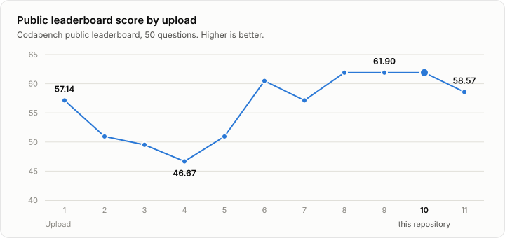
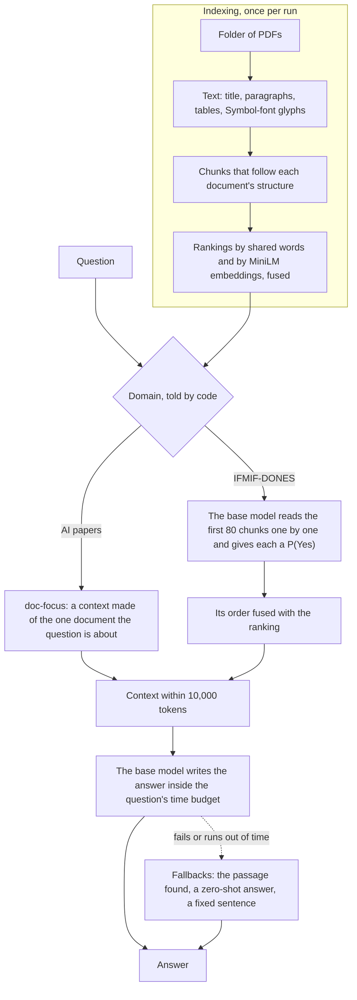

# Domain-specific question answering with a fixed LLM

My entry for the [IEEE-CIS Technical Challenge on Domain-Specific Question Answering with LLMs](https://cis.taskforce.ieee.org/gpais/tc-domain-qa-llms): a retrieval pipeline that answers questions about two document collections, AI papers and the IFMIF-DONES fusion project, with a base model I do not choose, offline and against the clock.

This repository holds the code of the tenth upload, the latest of the three that reached the entry's best public score, **61.90**.

<picture>
  <source media="(prefers-color-scheme: dark)" srcset="docs/scores-dark.svg">
  <source media="(prefers-color-scheme: light)" srcset="docs/scores-light.svg">
  
</picture>

## The problem

The evaluation takes a zip, imports its `main.py` and calls `answer(question, corpus_dir, model_id)` once per question, all in one process. The rules shape everything else:

- **No internet.** Only the packages pinned in [`requirements-participant.txt`](requirements-participant.txt) exist, and any auxiliary model has to travel inside the zip.
- **A base model chosen by the organizers**, loaded on their GPU. In the runs recorded here it is `allenai/Olmo-3.1-32B-Instruct`.
- **A time limit.** One hour for the 50 questions of the public leaderboard and two for the 100 of the private one, counted from the moment the code starts.
- **A blind corpus.** A folder of PDFs, real documents and distractors alike. Nothing says which document a question comes from.

## How it works



The entry is the package [`03_dsqa/dsqa`](03_dsqa/dsqa), one module per step:

| Step | Module | What it does |
| --- | --- | --- |
| Reading | `parse.py`, `tables.py`, `glyphs.py`, `text.py` | A PDF as text: its title, its paragraphs in file order, its tables found by the rules drawn across them, and the Symbol font's glyphs read as the characters they stand for. |
| Chunking | `chunk.py` | Chunks that follow the document's structure and fit what the embedder reads (254 tokens); a table stays in one piece under its caption. |
| Ranking | `rank.py`, `retrieval.py` | Chunks ranked by the words they share with the question and by embeddings (`all-MiniLM-L6-v2`, shipped in the zip), with the rankings fused. |
| Routing | `domain.py`, `route.py` | The domain of a question is told by code, and each domain is answered its own way. |
| AI papers | `focus.py` | When the rankings agree on one document, the context is that document alone: whole if it fits, otherwise its best chunks with their neighbours. |
| IFMIF-DONES | `relevance.py` | The base model doubles as a judge of relevance: it reads each candidate chunk in a prompt of its own and the chunks are reordered by its P(Yes). |
| Answering | `context.py`, `prompt.py`, `answering.py`, `engine.py` | The context is assembled within 10,000 tokens, the model is asked, and something is always returned. |
| Time | `budget.py` | Every question gets a share of the hour, and the run finishes with a margin. |
| Experiments | `variant.py` | Every change is a named adjustment that can be switched on and measured side by side. |

## Results

Scores on the public leaderboard (Codabench, 50 questions), in upload order:

| Upload | Date (2026) | Public score | What changed |
| --- | --- | --- | --- |
| 1 | Oct 11 | 57.14 | First version (`v1`). 16th of 30 entries at the time. |
| 2 | Oct 17 | 50.95 | Fixes to the PDF reading and the retrieval. |
| 3 | Oct 19 | 49.52 | A finalist of a round of experiments on time shares and per-domain handling. |
| 4 | not noted | 46.67 | Another finalist of the same round, with more adjustments stacked. |
| 5 | Oct 31 | 50.95 | The plainest finalist of that round. |
| 6 | Nov 13 | 60.48 | `v1` with `dones-plain`: IFMIF-DONES questions asked with the organizers' instruction over this entry's own ranking. |
| 7 | Nov 14 | 57.14 | `v1` with IFMIF-DONES questions answered by the organizers' RAG example itself. |
| 8 | Nov 15 | **61.90** | The stacked candidate: `doc-focus`, `doc-name` and `doc-reserve` for AI papers; `dones-plain`, `llm-rank` and `llm-wide` for IFMIF-DONES. |
| 9 | Nov 16 | **61.90** | Upload 8 with merged table cells written out and a context made of the five documents the model scores highest. |
| 10 | Nov 17 | **61.90** | Upload 8 with `llm-one`, `symbol-glyphs` and `llm-proof`. **This repository.** |
| 11 | Nov 20 | 58.57 | Upload 10's base with a second call that rewrites every answer. Not kept. |

The full record, with the hash of every zip, is in [`results/submissions.csv`](results/submissions.csv), and every measured run is a row of [`results/experiments.jsonl`](results/experiments.jsonl).

## Stack

- Python (the evaluation image runs 3.10), PyTorch and Hugging Face Transformers for the base model.
- `sentence-transformers` for the embeddings and PyMuPDF for the PDFs.
- pytest and ruff; Docker for a container that imitates the evaluation; Ollama to serve a small stand-in model on a laptop.

## Run it

Create a virtual environment with the packages of [`requirements-participant.txt`](requirements-participant.txt), which are the exact versions of the evaluation image, and add the development tools:

```bash
uv pip install -r requirements-participant.txt
uv pip install -r requirements-dev.txt
python -m pytest            # the fast tests
python -m pytest -m slow    # the examples and the entry with a small real model; needs a GPU
```

The development corpus is not in the repository, because its PDFs are copyrighted. [`dev/corpus/manifest.csv`](dev/corpus/manifest.csv) says what each document is and where it comes from, with its hash:

```bash
python -m tools.corpus                 # download what is open and verify all of it
python -m tools.evidence               # check the reference passages against the PDFs
```

Retrieval measured without a model, the whole entry with a stand-in for the base model, and the submission zip:

```bash
python -m tools.eval_retrieval --model-id <hf repo id> --system 03_dsqa
DSQA_ENGINE=<repo>/tools/engines/ollama.py python -m tools.run_local 03_dsqa \
    --model-id <the base model's id> --corpus-dir data/corpus --limit 3
python -m tools.build_entry --fetch-embedder    # the embedding model, once
python -m tools.build_entry                     # -> 03_dsqa_submission.zip
python -m tools.build_entry --check 03_dsqa_submission.zip
python -m tools.container_check                 # the entry in a Linux container, network cut
```

## Technical decisions

- **A run must never fail.** `answer()` returns a string whatever happens: if the package cannot be imported the model is asked without passages, and if the model cannot be loaded a fixed sentence is returned.
- **Time is a budget.** Each question gets a share of the hour, an answer cut short is asked for again in a few tokens, and the run is planned to end six minutes early.
- **Retrieval is measured before any GPU is rented.** `tools/eval_retrieval.py` checks, without a model, whether a passage that answers each question reaches the context, against reference passages for the question sets in [`dev/questions`](dev/questions).
- **Every change is a named adjustment.** `DSQA_VARIANT` switches adjustments on and off, a misspelt name is an error, and each measured run is appended to a ledger stamped with its commit. Rejected experiments stay as ablations.
- **The domain is told by code, not by the model**, and each domain has its own way of being answered.
- **The base model is its own reranker.** For IFMIF-DONES questions it scores each candidate chunk alone, through the same path every answer is written by, and the score is read from the logits.
- **PDFs are read for what they say.** Tables are found by their ruling lines and kept whole under their caption, and Symbol-font glyphs become the Greek letters and signs they draw.
- **The laptop rehearses the evaluation.** A Linux container with the network cut and the disk read-only, and stand-ins for the base model: a small model through Ollama, or an engine that only records the conversations it is shown.

## Status

- This is a snapshot of the tenth upload, not the working history. The files under `03_dsqa/` are those of the zip that was uploaded.
- The best public score is 61.90, reached by uploads 8, 9 and 10. A later attempt scored 58.57 and was not kept.
- Some comments mention a development journal (`docs/journal.md`). It is a working log and is not part of this repository.

## Repository layout

```
01_zero_shot/, 02_rag/    The organizers' example submissions, as they came
03_dsqa/                  The entry: main.py and the dsqa package
dev/                      Development corpus manifest and question sets with reference passages
docs/                     Charts and the starter kit's original README
results/                  Submissions record, experiment ledger and recorded runs
sample/                   The organizers' 25 sample questions
tests/                    Unit tests and checks of the environment and the build
tools/                    Local evaluator, retrieval lab, judge, ledger, container check, zip builder
```

## Credits and license

Built on the organizers' [starter kit](https://github.com/jucls/IEEE-CIS-DSQA-Starter-Kit) (MIT): `01_zero_shot/`, `02_rag/`, `sample/` and the RAG example reused inside `03_dsqa/` come from it. Its original README is in [`docs/starter-kit.md`](docs/starter-kit.md).

[MIT](LICENSE).
